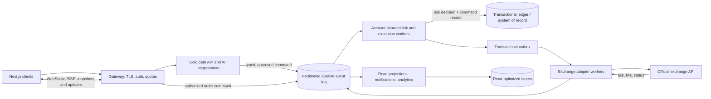

# TRADEGEN AI: scalable architecture direction

**Status:** target architecture, not implemented. The running code remains the small, in-memory demo described in the root README. No throughput, latency, availability, or financial-correctness claim in this document is a measured production result.

## Design goals and limits

Design for horizontal growth, isolate exchange execution from UI traffic, make every order decision auditable, and fail closed when authoritative state is missing. Capacity targets such as 100,000 concurrent sessions, millions of users, millisecond response times, and millions of events per second are workload and service-level objectives to benchmark; they do not follow automatically from using Rust, Kafka, Redis, or Kubernetes.

“Zero errors” cannot be guaranteed for a distributed system or external exchange. The engineering goal is to prevent duplicate financial effects, preserve a durable record of accepted commands, detect uncertainty, reconcile with the exchange, and stop new orders when state cannot be proven.

## Proposed service boundaries

The AI service is an untrusted planner in the cold path. It returns a validated strategy proposal. It receives no exchange secrets and has no import or network permission to call execution adapters. Only an approved, versioned command can enter the trading command path.

The low-latency risk decision runs on the account's owning shard using a versioned snapshot of approved strategy, limits, balance reservations, positions, and market-data freshness. A stale snapshot, unknown state, revoked permission, duplicate command, or unavailable durable log rejects or pauses the command. The UI, AI provider, analytics, email, and read projections are never dependencies of the risk decision.

## Order command lifecycle

1. Gateway authenticates the caller, checks account ownership and quotas, and requires a client idempotency key.
2. The command is schema-validated and normalized using decimal-safe amounts. It carries the approved strategy version and a unique command ID.
3. The command is routed by account ID to one ordered partition and one account-state owner. That owner checks permissions, emergency stop, market-data age, order constraints, reserved funds, open positions, daily loss, and deduplication.
4. A failed check writes a durable rejection/audit event and does not invoke an exchange adapter.
5. A passing check atomically records the authorization decision, reserves required funds/risk, and adds an outbox item. The API returns an accepted command ID only after this durable boundary.
6. An adapter worker submits the order using the same stable client order ID where the exchange supports it. A timeout after possible submission is **unknown**, not failed; the worker queries/reconciles before any retry.
7. Exchange acknowledgements, fills, cancels, and corrections are appended as immutable events. Ledger postings and read projections are derived idempotently. A reconciler compares local order/position state with exchange-reported state.

Do not claim exactly-once delivery across Kafka and an exchange. Use at-least-once message delivery plus idempotent consumers, durable command IDs, exchange client order IDs, transactional outbox/inbox patterns, and reconciliation. Never release a reservation or resubmit on an ambiguous timeout without a verified exchange state.

## Data ownership and consistency

- **Account shard:** single-writer owner for a given account's order authorization and reservation sequence. Partition/route by stable account ID; rebalance with fencing/leases so two workers cannot both own the same account.
- **Event log:** immutable command and outcome history, partitioned by account ID to preserve per-account order. Retention, replication, encryption, ACLs, schema evolution, replay limits, and disaster recovery are production requirements.
- **Financial ledger:** ACID, append-only double-entry postings with decimal amounts, currency, source event ID, and idempotency uniqueness. Use a relational distributed SQL store only after testing serializable transaction behavior, failover, contention, and recovery against the account-shard workload. Do not use a time-series database as the authoritative balance ledger.
- **Hot state:** Redis/Dragonfly may cache market data, sessions, or reconstructable projections. It is not the source of truth for balances, approvals, or order decisions unless a separately reviewed durable/consistency design proves that role.
- **Read models:** CQRS projections for dashboard history, analytics, and notifications can be eventually consistent. They must display freshness and must never authorize a trade.
- **Market data:** partition by venue/symbol, timestamp and sequence updates, detect gaps and stale feeds, and retain enough source references for replay. Exchange timestamps and local receive timestamps are distinct.

Kafka/Redpanda ordering is per partition, not global. A single account is deliberately serialized for correctness; scale across accounts with more partitions and shards. Hot accounts may need explicit capacity isolation rather than splitting one account's order sequence and risking races.

## Technology choices to evaluate

Keep Next.js for the client and a Python/FastAPI cold path for product APIs and AI orchestration. Isolate the risk/execution worker behind typed versioned messages. Benchmark Go first for operational simplicity and predictable concurrency; use Rust if measured tail latency, memory safety needs, or CPU profiles justify the additional implementation and operations cost. Language choice alone does not establish deterministic latency.

Evaluate Kafka or Redpanda for durable ordered event streams; a relational ACID ledger for authoritative accounting; Redis only for derived/ephemeral hot state; Envoy or Kong for ingress policy; Kubernetes with queue-lag autoscaling only after load tests and capacity safeguards. Autoscaling cannot instantly absorb bursts and must not create multiple owners for one account. Apply static capacity headroom and backpressure.

## Failure behavior

- Event log or ledger unavailable: reject new order commands; do not acknowledge a durable acceptance.
- Account state owner unavailable or lease uncertain: pause that account and fence the old owner before failover.
- Market data stale, sequenced updates missing, or exchange disconnected: reject new entries; retain existing exposure information and alert.
- Exchange submission timeout: mark `SUBMISSION_UNKNOWN`, query by stable client order ID, reconcile, then decide; do not issue a fresh order ID.
- Projection lag: keep trading path independent; show last-updated timestamps and lag to users.
- Queue lag or overload: apply admission control and per-account quotas. Do not drop accepted financial events to restore latency.
- Restart: replay from durable offsets and ledger checkpoints, reconcile exchange state, and restore an agent only after explicit policy and state checks.

## Security and service objectives

Use mTLS/service identities, least-privilege topics and database roles, secret-manager-backed exchange credentials, key rotation, strict tenant authorization at every boundary, tamper-evident audit retention, and redaction in logs/traces. Keep credentials out of event payloads. Establish SLOs for command acceptance, risk decision, exchange acknowledgement, reconciliation lag, event-log lag, and error budgets; report p50/p95/p99/p99.9 by region and exchange. A millisecond internal risk check is distinct from end-to-end order fill latency, which depends on network and exchange behavior.

Benchmark realistic order mixes, bursts, hot-account skew, consumer restarts, partition reassignment, region failover, database contention, exchange rate limits, and ambiguous submission timeouts. Use fault injection and reconciliation drills. Capacity numbers are published only after repeatable tests on the target deployment topology.

## Migration plan from this repository

1. **Current demo:** in-memory FastAPI, in-memory paper adapter, no auth, no durable ledger, no event bus, no live adapter. Keep isolated and local.
2. **Correctness foundation:** persistent auth/ownership, immutable audit and double-entry ledger, schema/migrations, transactional idempotency, recovery tests, and paper ledger reconciliation.
3. **Single-shard event workflow:** add a durable broker, outbox/inbox, account-keyed partitioning, one fenced worker owner per account, and fault-recovery tests. Continue paper-only.
4. **Sandbox adapters:** implement one official sandbox adapter, signed/secret-safe credential storage, timeout reconciliation, rate limits, and exchange conformance tests.
5. **Scale validation:** deploy representative multi-shard infrastructure; measure and publish capacity/SLOs under failure and skew; add read projections and websocket fan-out separately.
6. **Production readiness:** independent security, operational, financial-control, and jurisdictional reviews. Live trading stays feature-disabled until all prerequisites and approvals are met.

Do not add Kafka, a Rust service, or Kubernetes manifests as disconnected scaffolding. Each infrastructure component needs ownership, deployment, observability, security, failure semantics, and a verified integration path.
